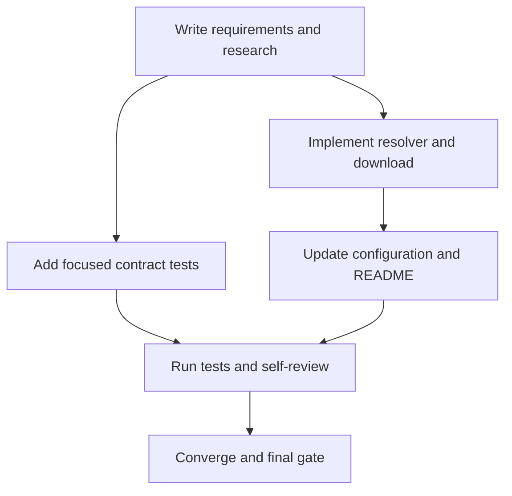

# Tasks: Automatic Goose acquisition

## Dependency graph

## Task list

### T1 — Specify and research acquisition behavior

- **Status:** complete
- **Depends on:** none
- **Deliverable:** requirements, research, design, plan, and status artifacts.
- **Acceptance:** pinned upstream release and failure behavior are documented.
- **Validation:** review `.specify/specs/003-goose-auto-install/*.md`.

### T2 — Implementing the verified Goose resolver

- **Status:** complete
- **Depends on:** T1
- **Deliverable:** update `scripts/migrate-zatca-master.sh`.
- **Acceptance:** explicit binary/PATH precedence, pinned Linux download, digest
  verification, cache reuse, atomic install, and fail-closed errors.
- **Validation:** `bash -n scripts/migrate-zatca-master.sh`.

### T3 — Adding automatic acquisition contract tests [P]

- **Status:** complete
- **Depends on:** T1
- **Deliverable:** extend `scripts/tests/test-migrate-zatca-master.sh`.
- **Acceptance:** download, cache reuse, and checksum failure are covered without
  network access.
- **Validation:** `bash scripts/tests/test-migrate-zatca-master.sh`.

### T4 — Documenting operator behavior

- **Status:** complete
- **Depends on:** T2
- **Deliverable:** update `config.env.example` and `README.md`.
- **Acceptance:** docs state that Goose is automatic when the optional binary is
  unset and identify the optional cache override.
- **Validation:** grep the docs for `ZATCA_MASTER_GOOSE_BIN` and
  `ZATCA_MASTER_GOOSE_CACHE_DIR`.

### T5 — Running validation and self-review

- **Status:** complete
- **Depends on:** T2, T3, T4
- **Deliverable:** focused tests, repository checks applicable to shell changes,
  diff review, and updated status.
- **Acceptance:** no in-scope failures or stale artifacts remain.
- **Validation:** focused test, `bash -n`, `git diff --check`.

### T6 — Converging the feature

- **Status:** blocked
- **Depends on:** T5
- **Deliverable:** convergence review and final acceptance evidence.
- **Acceptance:** no additional in-scope tasks are required and the designated
  QA agent approves the current revision.
- **Validation:** final artifact and source review.

## Adjacency list

- `T1`: —
- `T2`: `T1`
- `T3`: `T1`
- `T4`: `T2`
- `T5`: `T2`, `T3`, `T4`
- `T6`: `T5`

## Implementation waves

- **Wave 1:** T2 and T3 are independent by file ownership.
- **Wave 2:** T4 after T2.
- **Wave 3:** T5 and T6.
