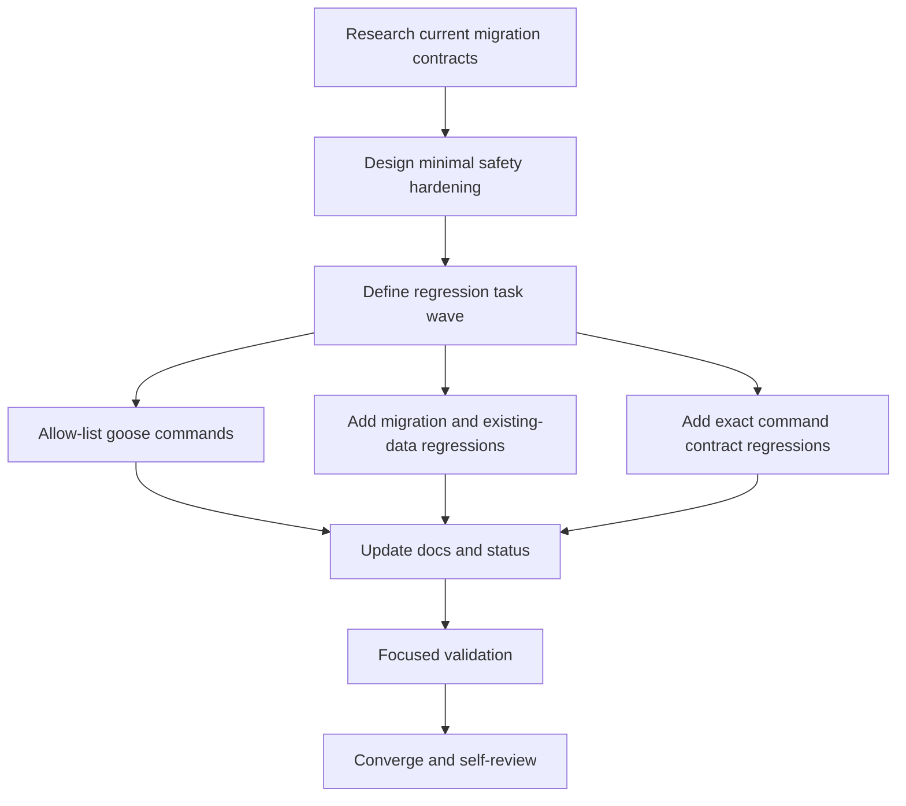

# Tasks: Deployment #185 Finding #4

## Dependency graph

## Task list

### T1 — Researching current migration contracts

- Depends on: none
- Deliverable: `research.md` records current code, tests, and runtime boundary.
- Acceptance: compose ambiguity is resolved from repository evidence; no
  implementation assumptions are left undocumented.
- Validation: inspect current scripts and focused tests.
- Status: done.

### T2 — Designing minimal safety hardening

- Depends on: T1
- Deliverable: `design.md` and requirement traceability.
- Acceptance: design preserves forward-only rollback and excludes legacy paths.
- Validation: compare design against `requirements.md` and `research.md`.
- Status: done.

### T3 — Defining regression task wave

- Depends on: T2
- Deliverable: this dependency-ordered task graph.
- Acceptance: every implementation task has a validation command/check.
- Validation: review graph and adjacency list.
- Status: done.

### T4 — Allow-listing goose commands

- Depends on: T3
- Deliverable: `scripts/lib.sh` rejects commands other than `up` and `status`
  before Docker execution.
- Acceptance: current callers remain valid; unsupported command has no Docker
  side effect.
- Validation: `bash scripts/tests/test-lib.sh`.
- Status: done.

### T5 — Adding migration and existing-data regressions

- Depends on: T3
- Deliverable: focused assertions for create-tenant, update, deploy-all,
  existing-data table/key validation, and status-only behavior.
- Acceptance: tests fail if migration ordering, required-table validation, or
  tenant-key propagation is removed or moved after the swap.
- Validation: `bash scripts/tests/test-init-tenant-db.sh` and
  `bash scripts/tests/test-tenant-migration-deploy.sh`.
- Status: done.

### T6 — Adding exact command contract regressions

- Depends on: T3
- Deliverable: exact `/app/migrate` argv/environment assertions for `up` and
  `status`, including rejection of legacy aliases.
- Acceptance: tests prove the backend migration binary receives only its
  documented environment names and subcommands.
- Validation: `bash scripts/tests/test-lib.sh`.
- Status: done.

### T7 — Updating docs and status

- Depends on: T4, T5, T6
- Deliverable: directly related README wording and current `STATUS.md`.
- Acceptance: docs match the implementation; no stale claims remain.
- Validation: inspect diff and run relevant contract tests.
- Status: done.

### T8 — Running focused validation

- Depends on: T7
- Deliverable: test output for focused shell checks and relevant dashboard Go
  tests/build/vet.
- Acceptance: all selected checks pass or blockers are recorded.
- Validation: commands listed in `STATUS.md`.
- Status: done. Normalized shell checks passed; direct Windows checkout
  invocation is CRLF/WSL constrained.

### T9 — Converging and self-reviewing

- Depends on: T8
- Deliverable: final diff review, artifact consistency, and explicit runtime-gap
  report.
- Acceptance: no unresolved requirement or safety regression remains.
- Validation: inspect `git diff --check`, `git diff`, and task/status alignment.
- Status: done. Final diff, artifact alignment, and runtime evidence boundary
  reviewed; no remaining actionable gaps found.

## Adjacency list

- T1: []
- T2: [T1]
- T3: [T2]
- T4: [T3]
- T5: [T3]
- T6: [T3]
- T7: [T4, T5, T6]
- T8: [T7]
- T9: [T8]

## Parallel-ready work

T4, T5, and T6 are logically independent after T3, but they touch related
contracts and will be performed serially in this single worktree to avoid
concurrent writers.
