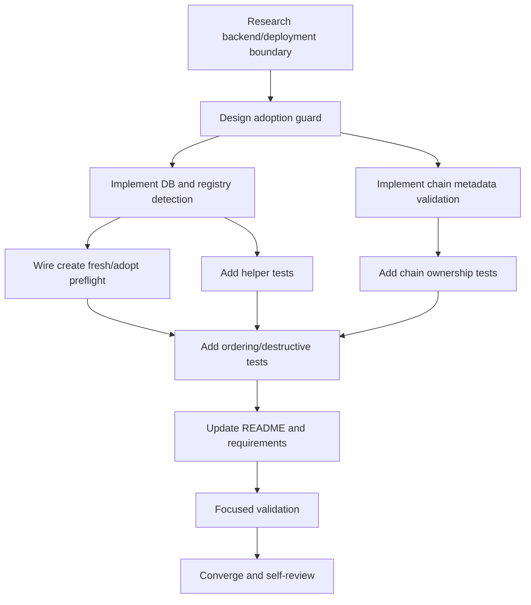

# Tasks: Deployment Migration Contract Blockers

## Dependency graph

## Task list

### T1 — Researching migration contract boundary

- Depends on: none
- Deliverable: `research.md` records repository evidence and unknown backend
  migration details.
- Acceptance: backend confirms the contiguous goose sequence and deployment
  does not reconstruct its SQL.
- Validation: inspect current scripts/history and ownership findings.
- Status: done.

### T2 — Designing fresh/adoption safety

- Depends on: T1
- Deliverable: `design.md` defines fail-closed DB/registry detection and
  unchanged migration/rollback paths.
- Acceptance: partial existing state requires explicit adoption.
- Validation: compare design with requirements and current interfaces.
- Status: done.

### T3 — Implementing existence helpers

- Depends on: T2
- Deliverable: escaped read-only helpers in `scripts/lib.sh`.
- Acceptance: query failure fails closed; DB and registry matches are detected.
- Validation: `bash scripts/tests/test-lib.sh`.
- Status: pending.

### T4 — Validating chain-owner schema metadata

- Depends on: T2
- Deliverable: read-only chain-owner metadata validation after goose.
- Acceptance: `branch_zatca_config` chain/reservation columns and
  `zatca_submission(branch_id, invoice_icv)` uniqueness are checked without
  deployment-owned DDL or chain runtime writes.
- Validation: `bash scripts/tests/test-init-tenant-db.sh`.
- Status: done.

### T5 — Wiring create fresh/adopt preflight

- Depends on: T3
- Deliverable: `create-tenant.sh --adopt-existing` and pre-Dokku guard.
- Acceptance: fresh default refuses existing DB/registry; explicit adoption
  continues; `--update` remains separate.
- Validation: `bash scripts/tests/test-create-tenant.sh`.
- Status: done.

### T6 — Testing helper outcomes

- Depends on: T3
- Deliverable: deterministic stub-MySQL helper tests.
- Acceptance: absent, DB-only, registry-only, both, and query failure cases
  are covered.
- Validation: `bash scripts/tests/test-lib.sh`.
- Status: done.

### T7 — Testing chain-owner contract

- Depends on: T4
- Deliverable: ownership and final schema sequence regressions.
- Acceptance: no `pkg/egschain` references or deployment-owned chain SQL;
  target-image goose remains the only migration source.
- Validation: `bash scripts/tests/test-tenant-migration-deploy.sh`.
- Status: done.

### T8 — Testing ordering and destructive guards

- Depends on: T5, T6, T7
- Deliverable: migration deployment, initializer, and rollback regressions.
- Acceptance: target-image goose and chain validation precede backend startup;
  `down` is rejected; rollback runs no goose.
- Validation: focused migration/init/rollback shell tests.
- Status: done.

### T9 — Updating deployment documentation

- Depends on: T8
- Deliverable: README and REQUIREMENTS adoption/version contract.
- Acceptance: docs match the new flag and runtime evidence boundary.
- Validation: documentation grep/inspection.
- Status: done.

### T10 — Running focused validation

- Depends on: T9
- Deliverable: shell and relevant Go test results.
- Acceptance: selected checks pass or blockers are recorded.
- Validation: commands listed in STATUS.
- Status: done. Native Git Bash normalized checks passed; WSL was
  unavailable, so no Docker/MySQL runtime was attempted.

### T11 — Converging and self-reviewing

- Depends on: T10
- Deliverable: final diff review and local commit with no unrelated edits.
- Acceptance: no migration/rollback safety regression remains.
- Validation: `git diff --check`, status, and commit inspection.
- Status: done. Final scope review found no deployment-owned chain SQL and
  preserved backend/ZATCA ownership.

## Adjacency list

- T1: []
- T2: [T1]
- T3: [T2]
- T4: [T2]
- T5: [T3]
- T6: [T3]
- T7: [T4]
- T8: [T5, T6, T7]
- T9: [T8]
- T10: [T9]
- T11: [T10]
