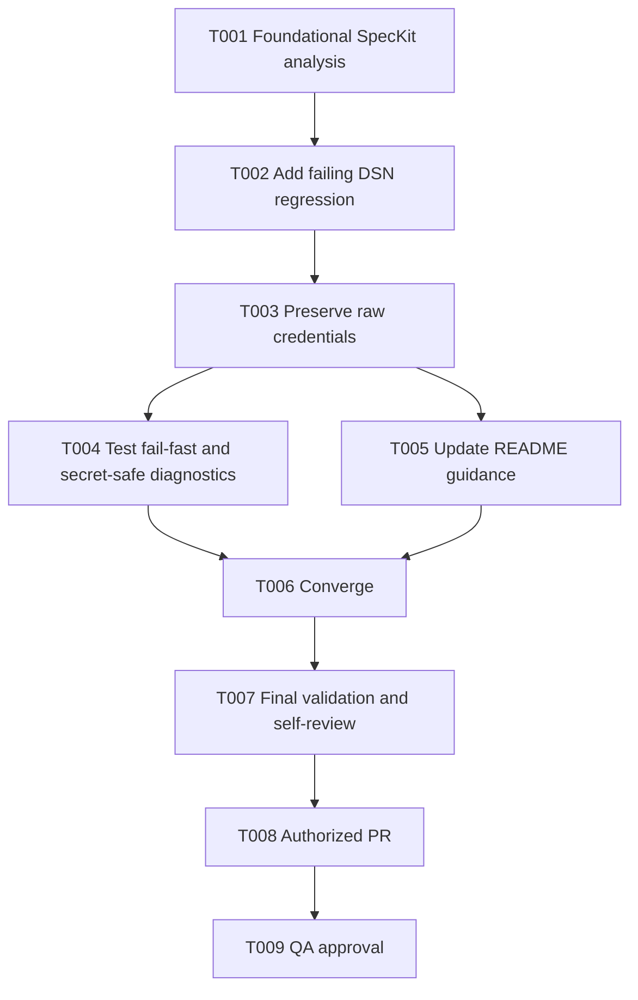

# Tasks: Goose MySQL Authentication Parity

**Input**: Design documents from `specs/001-goose-auth-parity/`

**Prerequisites**: `plan.md`, `spec.md`, `research.md`, `design.md`, and
`data-model.md`

**Tests**: Focused regression tests are required by the acceptance criteria.
They use only the existing stubs and dummy credentials.

**Organization**: Tasks are grouped by user story and include explicit
dependencies and validation.

## Phase 1: Setup

The current-main baseline, worktree, and feature artifacts are already
established. No additional project setup task is required.

## Phase 2: Foundational Analysis

**Purpose**: Resolve specification/design/task gaps before source edits.

- [x] T001 Perform the read-only `/speckit-analyze` cross-artifact review for
  `specs/001-goose-auth-parity/requirements.md`, `spec.md`, `research.md`,
  `design.md`, `plan.md`, and `tasks.md`; resolve all findings before
  implementation.
  - **Depends on**: None
  - **Acceptance**: The analyzer reports no unresolved contradictions or
    missing requirement coverage.
  - **Validation**: Map each functional requirement and buildable success
    criterion to tasks; confirm no unresolved contradictions or coverage gaps.

## Phase 3: User Story 1 - Provision with the configured host database (P1)

**Goal**: Preserve the configured database credentials when passing them to
Goose.

**Independent Test**: The migration contract test uses a dummy password with
punctuation and verifies the Goose bridge receives the exact configured value.

### Tests

- [x] T002 [US1] Add a regression case in
  `scripts/tests/test-migrate-zatca-master.sh` that sets a quoted dummy
  password containing `%`, `@`, `:`, `/`, `?`, `#`, and `;`, runs Goose through
  the bridge stub, and asserts the captured credential is unchanged and the
  Goose connection has `timeout=5s`.
  - **Depends on**: T001
  - **Acceptance**: The new assertion fails against the current percent-encoded
    formatter and does not print the dummy password.
  - **Validation**: `bash scripts/tests/test-migrate-zatca-master.sh`
    (the new assertion is expected to fail before T003)

### Implementation

- [x] T003 [US1] Remove the credential percent-encoding helper and pass the
  configured username/password directly to the MySQL driver DSN in
  `scripts/migrate-zatca-master.sh`; set the Goose TCP timeout to five seconds
  and pass `--connect-timeout=5` to both preflight client checks.
  - **Depends on**: T002
  - **Acceptance**: The regression fixture reaches Goose with the original
    credential bytes; both readiness clients and Goose have five-second
    connection bounds; host resolution, bridge routing, and migration ordering
    remain unchanged.
  - **Validation**: `bash scripts/tests/test-migrate-zatca-master.sh`

## Phase 4: User Story 2 - Diagnose a failed database check (P2)

**Goal**: Keep failure output actionable and secret-safe while preserving
fail-fast behavior.

**Independent Test**: Stub authentication and connectivity failures and verify
they remain distinguishable, do not reveal the dummy credential, and do not
create a backup after failed preflight.

- [x] T004 [P] [US2] Extend the error-path assertions in
  `scripts/tests/test-migrate-zatca-master.sh` to check authentication versus
  connection classification, absence of the dummy password/DSN in output, and
  no backup after failed preflight; assert the five-second timeout is present
  in the client preflight arguments.
  - **Depends on**: T003
  - **Acceptance**: Each failure remains fail-closed and the captured output
    contains no credential value or credential-bearing DSN.
  - **Validation**: `bash scripts/tests/test-migrate-zatca-master.sh`

- [x] T005 [P] [US2] Update the host-MySQL setup and migration guidance in
  `README.md` to explain that Goose and readiness checks use the configured
  endpoint/credentials and to direct operators to verify the matching MySQL
  account after an authentication rejection.
  - **Depends on**: T003
  - **Acceptance**: Guidance is consistent with the implemented host-gateway
    and credential behavior and contains no secrets.
  - **Validation**: Review the README change against `specs/001-goose-auth-parity/spec.md`

## Phase 5: Convergence, Review, and Delivery

**Purpose**: Confirm full requirement coverage, validate the change, and
prepare an authorized pull request.

- [x] T006 Perform a read-only convergence assessment of the specification,
  plan, tasks, and implementation; record any remaining work in
  `specs/001-goose-auth-parity/tasks.md` and `STATUS.md`.
  - **Depends on**: T004, T005
  - **Acceptance**: Convergence reports `Converged`; any appended task is
    completed before proceeding.
  - **Validation**: Confirm no code gaps remain; append no convergence tasks.

- [x] T007 Self-review the changes and feature artifacts, then run Bash syntax,
  the migration contract test, and whitespace validation for
  `scripts/migrate-zatca-master.sh`, `scripts/tests/test-migrate-zatca-master.sh`,
  `README.md`, and `specs/001-goose-auth-parity/`.
  - **Depends on**: T006
  - **Acceptance**: All available checks pass; unavailable live MySQL evidence
    is recorded as unavailable, not passed.
  - **Validation**: `bash -n scripts/migrate-zatca-master.sh scripts/tests/test-migrate-zatca-master.sh`;
    `bash scripts/tests/test-migrate-zatca-master.sh`; `git diff --check`

- [ ] T008 Use the verified active GitHub CLI identity `abdulmohsenssda`,
  search for the repository's pull-request template, push
  `fix/goose-dsn-auth-parity-20261114`, and open a PR against `main` containing
  `scripts/migrate-zatca-master.sh`,
  `scripts/tests/test-migrate-zatca-master.sh`, and `README.md`.
  - **Depends on**: T007
  - **Acceptance**: The PR is open under the authorized identity; no push or
    PR creation uses `almaabd16` or `almaabd16_bhgithub`.
  - **Validation**: Verify the `gh` account before push and confirm the PR URL
    and changed-file list after creation.

- [ ] T009 Submit evidence for all acceptance criteria in the feature chat and
  obtain approval from the designated QA identity; update
  `specs/001-goose-auth-parity/STATUS.md` with the final gate result.
  - **Depends on**: T008
  - **Acceptance**: The current feature revision is approved by
    `copilot-goose-auth-qa`; developers do not mark the QA gate approved.
  - **Validation**: Feature-chat QA decision is `approved` for the current
    revision.

## Dependency Graph

**Foundational blocker**: T001 blocks source changes until artifact analysis
is resolved. T006 is the convergence gate; T007 is the final local validation
gate. T008 requires the authorized GitHub identity, and T009 requires the
separate QA identity.

## Dependency Adjacency List

- **T001**: None
- **T002**: T001
- **T003**: T002
- **T004**: T003
- **T005**: T003
- **T006**: T004, T005
- **T007**: T006
- **T008**: T007
- **T009**: T008

## Parallel Opportunities

T004 and T005 touch different files and can proceed independently after T003.
All earlier implementation work is serial because it shares the migration
test or script. No separate worktree or parallel writer is needed.

## Implementation Strategy

1. Complete T001 before any implementation.
2. Deliver the P1 path with T002 and T003, then validate the focused contract
   test independently.
3. Complete the P2 diagnostics/documentation tasks T004 and T005.
4. Converge, self-review, and pass the final local validation gate before
   creating a PR.
5. Submit evidence and wait for the designated QA approval without claiming it
   on behalf of QA.
