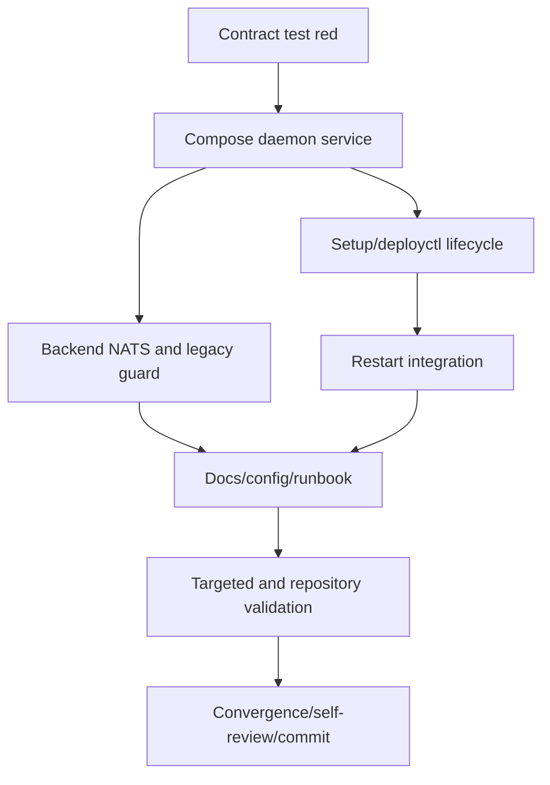

# Tasks: ZATCA Daemon Deployment Service

## Dependency graph

## Adjacency list

- `T009-1`: no dependencies; validation is the expected failing focused test.
- `T009-2`: depends on `T009-1`; add the daemon compose contract.
- `T009-3`: depends on `T009-2`; add setup script and command mapping.
- `T009-4`: depends on `T009-2`; wire tenant NATS and prevent a second broker.
- `T009-5`: depends on `T009-3`; include daemon in restart ordering.
- `T009-6`: depends on `T009-4`, `T009-5`; document config, grants, SDK/runtime.
- `T009-7`: depends on `T009-6`; run syntax, focused shell, Go, and diff checks.
- `T009-8`: depends on `T009-7`; converge, self-review, and commit.

## Deliverables

- [x] **T009-1** Add `scripts/tests/test-zatca-daemon.sh`; run red on `aea7b6e`.
  Validation: `bash scripts/tests/test-zatca-daemon.sh` fails because the
  daemon compose service is absent.
- [x] **T009-2** Add `dashboard/docker-compose.zatca.yml` with the T008 image,
  NATS/JetStream, MySQL, XML, restart, and authenticated health contracts.
  Validation: focused contract test assertions.
- [x] **T009-3** Add `scripts/setup-zatca-daemon.sh` and
  `deployctl.sh setup zatca` mapping with required-input validation.
  Validation: `bash -n` and `deployctl --plan setup zatca`.
- [x] **T009-4** Wire `ZATCA_NATS_URL` into tenant creation and guard
  `setup-nats.sh` when the daemon owns NATS.
  Validation: shell syntax and focused contract assertions.
- [x] **T009-5** Update `restart-stack.sh` to stop/start the enabled daemon
  around Dokku and include it in status output.
  Validation: existing restart-stack shell contract plus syntax.
- [x] **T009-6** Update config examples, `README.md`, `REQUIREMENTS.md`, and
  `templates/README.md` with SDK/runtime, DB grants, health, storage, and
  operator commands; no secrets.
  Validation: documentation review and secret scan.
- [x] **T009-7** Run targeted shell checks, all applicable deployment shell tests,
  and dashboard `go test`, `go vet`, and `go build`.
  Validation: command results recorded in STATUS.
- [x] **T009-8** Run convergence/self-review and create one isolated commit.
  Validation: clean working tree except commit and `git show --check`.
