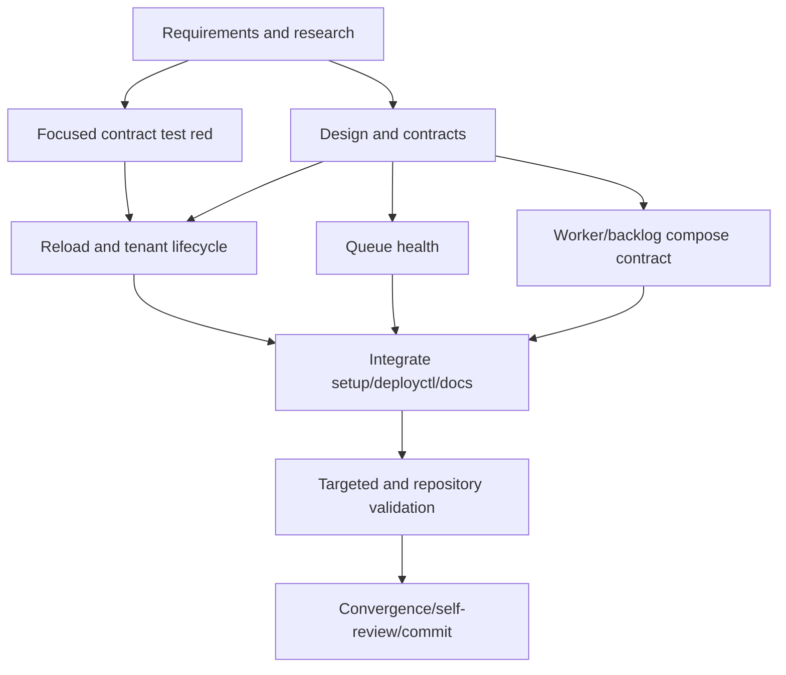

# T033 Tasks

## Dependency graph

## Adjacency list

- `T033-REQ`: no dependencies; foundational blocker.
- `T033-RED`: depends on `T033-REQ`; expected failing contract gate.
- `T033-DESIGN`: depends on `T033-REQ`; design/contracts are reviewable before
  source implementation.
- `T033-RELOAD`: depends on `T033-RED` and `T033-DESIGN`; tenant read-back and
  controlled daemon reload.
- `T033-HEALTH`: depends on `T033-DESIGN`; bounded authenticated stream and
  consumer health.
- `T033-BOUNDS`: depends on `T033-DESIGN`; numeric validation and compose
  forwarding.
- `T033-INTEGRATE`: depends on `T033-RELOAD`, `T033-HEALTH`, and `T033-BOUNDS`;
  setup/deployctl and operator docs.
- `T033-GREEN`: depends on `T033-INTEGRATE`; all requested validation gates.
- `T033-CONVERGE`: depends on `T033-GREEN`; final artifact/diff/commit gate.

## Deliverables

- [x] T033-REQ — create requirements, research, design, plan, spec, data model,
  deployment contract, quickstart, task graph, checklist, and status artifacts.
  Validation: artifact consistency review.
- [x] T033-RED — add `scripts/tests/test-zatca-scale.sh` and run it against
  e289a72 before production changes. Validation: expected missing-contract
  failure.
- [x] T033-RELOAD — add `scripts/reload-zatca-daemon.sh`, registry read-back,
  and opt-in invocation from `scripts/create-tenant.sh`. Validation: shell
  syntax and focused contract assertions.
- [x] T033-HEALTH — add `scripts/health-zatca-daemon.sh` with bounded
  authenticated `/healthz` and `/jsz` checks. Validation: static contract and
  parser fixture/stub checks.
- [x] T033-BOUNDS — validate and forward finite worker/backlog settings in
  `dashboard/docker-compose.zatca.yml` and config examples. Validation:
  focused contract and Compose interpolation when Docker is available.
- [x] T033-INTEGRATE — wire setup/deployctl and update relevant deployment
  README/runbooks without credentials. Validation: targeted shell tests and
  documentation review.
- [x] T033-GREEN — run shell syntax, focused/existing deployment tests, and
  dashboard `go test`, `go vet`, and `go build`. Validation: command results
  recorded in `STATUS.md`.
- [x] T033-CONVERGE — run convergence/checklist/self-review and create one
  isolated commit with no push/PR. Validation: `git diff --check`, clean status,
  and commit inspection.

## Parallel-ready work

After T033-RED and T033-DESIGN, the health and compose-bound work are logically
independent, but they share the compose/setup contract in one worktree and
will be applied sequentially. No parallel writer is used for this lane.

## Implementation strategy

Use the smallest compatibility-first increment: registry read-back and
controlled reload, then queue health, then additive bounds/config/docs, followed
by full validation and convergence. The existing T009 path remains the
rollback baseline.
